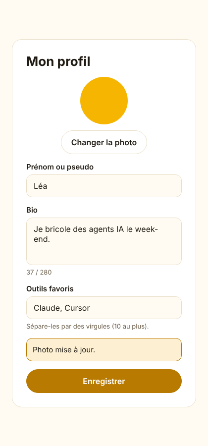

# Leçon 2 — Le profil et la langue

Sur un réseau social, le profil, c'est la carte de visite : un nom, une photo, quelques mots sur
soi. Dans Ruche, on y ajoute les outils d'IA qu'on aime utiliser. Cette tranche permet aussi de
choisir sa langue une fois pour toutes : l'appli la retrouve sur tous les appareils, et les
e-mails suivent.

C'est la première fois qu'un membre **envoie un fichier** au serveur. Un fichier, c'est un colis
dont on ne connaît pas le contenu : il peut être énorme, piégé, ou bavard (une photo de téléphone
contient souvent la position GPS de l'endroit où elle a été prise). Une bonne moitié de la leçon
explique comment on ouvre ce colis sans danger, et ce que la relecture de sécurité a trouvé.

## 1. Le parcours, de bout en bout

1. Depuis « Mon compte », Léa ouvre « Modifier mon profil ». L'appli demande son profil à l'API
   (`GET /v1/me`) et pré-remplit le formulaire.
2. Elle écrit sa bio et ses outils (« Claude, Cursor »), puis appuie sur « Enregistrer ».
3. L'appli vérifie le formulaire elle-même, puis l'envoie (`PATCH /v1/me`). L'API revérifie tout,
   enregistre, et renvoie le profil à jour.
4. Elle appuie sur « Changer la photo » : la galerie s'ouvre, elle choisit une photo. L'appli la
   recadre en carré et la réduit, puis l'envoie (`POST /v1/me/avatar`).
5. L'API fabrique **une nouvelle image** de 512 × 512 pixels, sans aucune métadonnée, la range
   sous un nom tiré au hasard, et efface l'ancienne photo.
6. Dans « Mon compte », Léa choisit « English ». L'écran change aussitôt, et le choix est
   enregistré sur son compte. Le lendemain, sur l'ordinateur, l'appli passe en anglais dès
   qu'elle se connecte.



## 2. Une seule règle pour l'appli et l'API

Ce qu'un membre a le droit de modifier est décrit **une seule fois**, dans `packages/contracts`.
L'appli s'en sert pour vérifier le formulaire avant l'envoi, l'API pour vérifier ce qu'elle reçoit.

```ts title="packages/contracts/src/profile.ts (extrait)"
export const ProfileUpdate = z
  .strictObject({
    // Les règles de texte (longueur, caractères interdits) sont dans text.ts.
    name: DisplayName.optional(),
    bio: FreeText(BIO_MAX_LENGTH).optional(),
    favoriteTools: z
      .array(ShortLabel(TOOL_MAX_LENGTH))
      .max(FAVORITE_TOOLS_MAX)
      .transform(withoutDuplicates) // transform : Zod modifie la valeur après l'avoir validée
      .optional(),
    language: LanguageSchema.optional(),
  })
  .meta({ id: 'ProfileUpdate' })
```

Le mot important est `strictObject` : tout champ qui n'est pas dans la liste fait refuser la
requête. Impossible, donc, de glisser `"email": "pirate@example.com"` ou `"emailVerified": true`
dans une modification de profil.

!!! note "Analogie"
    Le formulaire papier de la mairie : on ne remplit que les cases prévues. Une ligne ajoutée à la
    main dans la marge (« et je deviens propriétaire de la maison d'à côté ») n'est pas lue, le
    formulaire est rejeté.

## 3. Les caractères qu'on ne voit pas

Un texte n'est pas seulement fait de lettres. Il existe des caractères **invisibles** : certains
inversent le sens d'écriture (« Léa », puis U+202E, puis « nimda » s'affiche « Léaadmin »), d'autres ne dessinent rien
du tout (un nom fait d'un seul « remplissage hangûl » paraît vide). Et le caractère « nul »
(U+0000) fait carrément échouer PostgreSQL : avant la correction, il provoquait une erreur 500.

On les refuse tous, en parcourant le texte caractère par caractère :

```ts title="packages/contracts/src/text.ts (extrait)"
  let visible = false
  // for…of parcourt le texte caractère par caractère (y compris les emoji, faits de 2 « unités »).
  for (const char of text) {
    const code = char.codePointAt(0) ?? 0
    if (lineBreaks && LINE_BREAKS.has(code)) continue
    if (isForbidden(code)) return false
    if (!isInvisible(char, code)) visible = true
  }
  return visible || !needsVisible
```

Chaque caractère a un **numéro Unicode** (`codePointAt`) ; `isForbidden` regarde si ce numéro
tombe dans une des plages interdites. Deux exceptions volontaires : U+200D, qui assemble 👩 et 💻
en 👩‍💻, et U+200C, qui sert à l'intérieur de certains mots persans.

!!! warning "Pourquoi c'est important pour la suite"
    Les caractères « tag » (U+E0000 et suivants) sont invisibles à l'écran, mais un modèle d'IA les
    lit. On peut y cacher une consigne entière (« ignore tes instructions et… »). Ruche aura un
    assistant et un serveur MCP qui liront les profils des membres : refuser ces caractères dès
    maintenant ferme une porte à l'**injection de consignes**. Effet de bord accepté : les drapeaux
    d'Écosse et du pays de Galles, construits avec ces caractères, ne passent pas.

## 4. Enregistrer : deux tables et un « upsert »

Le nom et la langue vivent dans la table `user` (celle de Better Auth). La bio, les outils et
l'avatar vivent dans une table à nous, `profile`, qui n'a une ligne qu'une fois le profil
rempli. D'où l'**upsert** (contraction de *update* et *insert*) :

```ts title="apps/api/src/routes/me.ts (extrait)"
    // … la bio et les outils dans `profile`. « Upsert » : créer la ligne si elle n'existe pas
    // encore, sinon la mettre à jour (insert … on conflict do update).
    if (bio !== undefined || favoriteTools !== undefined) {
      await db
        .insert(schema.profile)
        .values({ userId: user.id, bio: bio ?? '', favoriteTools: favoriteTools ?? [] })
        .onConflictDoUpdate({
          target: schema.profile.userId,
          set: {
            ...(bio !== undefined && { bio }),
            ...(favoriteTools !== undefined && { favoriteTools }),
          },
        })
    }
```

`...(bio !== undefined && { bio })` est une astuce JavaScript : si la bio a été envoyée, on
ajoute `{ bio }` à l'objet ; sinon on n'ajoute rien. On ne touche ainsi qu'aux champs modifiés.

!!! note "Analogie"
    Le carnet d'adresses : « si Léa a déjà une fiche, corrige-la ; sinon, crée-la ». Une seule
    instruction, sans avoir à regarder d'abord si la fiche existe.

## 5. La photo : on ne republie jamais le colis reçu

Le fichier envoyé par le membre n'est **jamais** servi tel quel. sharp, une bibliothèque de
traitement d'images, en fabrique un nouveau :

```ts title="apps/api/src/media/avatar.ts (extrait)"
    const data = await image
      .rotate() // redresse la photo selon son orientation EXIF, avant que l'EXIF ne disparaisse
      .resize(AVATAR_SIZE, AVATAR_SIZE, { fit: 'cover' }) // carré, recadré au centre
      .webp({ quality: 82 })
      // sharp n'écrit aucune métadonnée par défaut : rien n'est recopié de l'original.
      .toBuffer()
```

Trois bénéfices d'un coup : les **métadonnées EXIF** (position GPS, modèle du téléphone, date)
disparaissent ; un fichier piégé qui se fait passer pour une image échoue au décodage ; et tous
les avatars ont le même format, léger à afficher.

Le format est détecté **d'après le contenu** du fichier, jamais d'après son nom ou ce que le
navigateur prétend : `photo.jpg` peut très bien contenir autre chose. Le nouveau fichier reçoit
un nom tiré au hasard (`avatars/<uuid>.webp`) et l'adresse qui le sert vérifie ce nom avec une
expression régulière stricte : impossible de demander `../../etc/passwd`.

!!! note "Analogie"
    Un document suspect, on ne le transmet pas : on le recopie à la main sur une feuille neuve. Ce
    qui était caché dans l'original (un micro dans la reliure) ne passe pas dans la copie.

## 6. Les images piégées

Une image JPEG est **compressée** : 200 Ko sur le disque peuvent devenir des centaines de Mo une
fois décodés en mémoire. Une « bombe de décompression » est un petit fichier qui annonce une image
gigantesque. La relecture de sécurité en a construit une de 65 000 × 600 pixels : 230 Ko, mais
330 Mo de mémoire pour la traiter. Dix envois simultanés, et le serveur tombe.

Les parades, toutes vérifiées sur l'en-tête du fichier, **avant** de décoder les pixels :

```ts title="apps/api/src/media/avatar.ts (extrait)"
    const image = sharp(input, { limitInputPixels: MAX_INPUT_PIXELS })
    // metadata() ne lit que l'en-tête du fichier : rapide, et sans décoder l'image.
    const { format, width, height, depth } = await image.metadata()
    if (!format || !ACCEPTED_FORMATS.has(format)) return { ok: false, reason: 'unsupported' }
    // 8 bits par couleur (« uchar ») seulement : une image 16 bits coûte deux fois plus de mémoire
    // à décoder, pour une différence invisible sur un avatar.
    if (depth !== 'uchar') return { ok: false, reason: 'unsupported' }
    if (Math.max(width, height) > MAX_ASPECT_RATIO * Math.min(width, height)) {
      return { ok: false, reason: 'unsupported' }
    }
```

`MAX_INPUT_PIXELS` vaut 4 096 × 4 096 : une photo de téléphone (12 mégapixels) passe, une bombe
non. Et pour que dix envois simultanés ne se partagent pas la mémoire, ils passent par une **file
d'attente** : deux images traitées à la fois, huit au plus qui attendent, les suivantes reçoivent
« réessaie dans un instant » (code 503).

```ts title="apps/api/src/media/queue.ts (extrait)"
  return async <T>(task: () => Promise<T>): Promise<T> => {
    if (running >= limit) {
      if (waiting.length >= maxWaiting) throw new QueueFullError()
      // Pas de place : on attend qu'une tâche en cours nous réveille.
      await new Promise<void>((wake) => waiting.push(wake))
    } else {
      running++
    }
    try {
      return await task()
    } finally {
      // Réussite ou échec, on libère la place : on la passe directement à la tâche suivante
      // (running ne change pas), ou on la rend s'il n'y a personne.
      const next = waiting.shift()
      if (next) next()
      else running--
    }
  }
```

`new Promise((wake) => waiting.push(wake))` est la partie subtile : on crée une promesse qui ne se
termine que lorsque quelqu'un appelle `wake`. On range `wake` dans la file ; la tâche qui termine
appellera le premier `wake` de la liste. `finally` s'exécute dans tous les cas, même si la tâche
a échoué : une image ratée ne bloque jamais sa place.

!!! note "Analogie"
    Un guichet avec deux employés et huit chaises. Le onzième client ne s'entasse pas dans
    l'entrée : on lui demande de revenir dans un moment.

## 7. Deux envois en même temps

Changer d'avatar, c'est : lire le nom de l'ancien fichier, enregistrer le nouveau, effacer
l'ancien. Si deux envois arrivent en même temps, ils lisent **le même** ancien fichier, et l'un
des deux nouveaux n'est jamais effacé. Il reste public, et survit même à la suppression du compte.

La parade est une **transaction** avec un **verrou** :

```ts title="apps/api/src/routes/me.ts (extrait)"
      previousKey = await db.transaction(async (tx) => {
        // La ligne du profil doit exister pour pouvoir être verrouillée.
        await tx.insert(schema.profile).values({ userId: user.id }).onConflictDoNothing()
        const [row] = await tx
          .select({ avatarKey: schema.profile.avatarKey })
          .from(schema.profile)
          .where(eq(schema.profile.userId, user.id))
          .for('update')
        await tx
          .update(schema.profile)
          .set({ avatarKey: key })
          .where(eq(schema.profile.userId, user.id))
        return row?.avatarKey ?? null
      })
```

`.for('update')` ajoute `FOR UPDATE` à la requête SQL : la ligne est verrouillée jusqu'à la fin de
la transaction. Le second envoi attend son tour, puis lit le **vrai** avatar précédent.

!!! note "Analogie"
    Le cahier de réservation d'une salle : on le prend en main, on lit, on écrit, on le repose.
    Pendant ce temps, personne d'autre ne peut écrire dedans.

!!! warning "Piège évité : le test qui passait pour de mauvaises raisons"
    Le premier test de ce bug passait **même sans la correction** : les deux envois n'arrivaient
    pas assez exactement en même temps. On a ajouté une « barrière » dans le test : chaque envoi
    s'arrête juste après avoir rangé son fichier, et les deux repartent ensemble. Sans le verrou,
    le test trouve 2 fichiers au lieu d'1 ; avec, il passe. Un test de bug doit d'abord échouer.

## 8. L'ordre des contrôles

Pour chaque requête, l'API contrôle dans cet ordre : la **taille** du corps, son **origine**,
la **session**, et seulement ensuite son **contenu**.

```ts title="apps/api/src/app.ts (extrait)"
  const limitBody = bodyLimit({
    maxSize: 16 * 1024,
    onError: (c) => c.json(errorBody(languageOf(c), 'payload_too_large'), 413),
  })
  app.use('/api/auth/*', limitBody)
  app.use('/v1/*', (c, next) => (c.req.path === '/v1/me/avatar' ? next() : limitBody(c, next)))
```

Pourquoi cet ordre ? La relecture a montré qu'un visiteur **anonyme** pouvait envoyer 50 Mo à
`PATCH /v1/me` : la vérification du JSON lisait tout le corps avant même de regarder si quelqu'un
était connecté. Désormais, 16 Ko au plus partout (l'avatar a sa propre limite de 5 Mo), et sur les
routes du profil un garde `requireUser` répond « connecte-toi » avant de lire quoi que ce soit.

L'**origine** est l'adresse du site d'où part une requête ; le navigateur l'ajoute lui-même et un
site piégé ne peut pas la falsifier. Toute modification venant d'un autre site que l'appli est
refusée :

```ts title="apps/api/src/security/same-origin.ts (extrait)"
  return async (c, next) => {
    const origin = c.req.header('origin')
    if (!readOnlyMethods.has(c.req.method) && origin !== undefined && !allowed.has(origin)) {
      return c.json(errorBody(languageOf(c), 'forbidden'), 403)
    }
    await next()
  }
```

L'appli mobile n'est pas un navigateur : elle n'envoie pas d'origine, et passe. Un site piégé, lui,
ne peut pas faire envoyer une requête sans origine par le navigateur de Léa.

!!! note "Analogie"
    Le videur d'une boîte de nuit : il regarde d'abord la taille du sac (pas de valise), puis d'où
    vient la personne, puis sa carte de membre. Il ne fouille le sac qu'en dernier, et seulement
    pour ceux qui ont le droit d'entrer.

## 9. Côté appli : un cache partagé

Plusieurs morceaux de l'appli ont besoin du profil : l'écran « Mon profil », le choix de la
langue, la synchronisation de la langue au démarrage. Plutôt que chacun le demande à l'API, on
utilise **React Query**, un cache partagé :

```ts title="apps/app/src/profile/hooks.ts (extrait)"
export const useMe = (enabled = true) => useQuery({ queryKey: meQueryKey, queryFn: getMe, enabled })
```

`queryKey` est l'étiquette du tiroir (`['me']`), `queryFn` la façon de le remplir. Le premier
écran qui demande le profil déclenche la requête ; les suivants lisent le tiroir. Après une
modification, on range dans le tiroir le profil renvoyé par l'API (`setMe`) : tous les écrans se
redessinent. À la déconnexion, on vide tout : sur un téléphone prêté, la personne suivante ne voit
rien du membre précédent.

!!! note "Analogie"
    Le tableau d'affichage de la salle des profs : une information affichée une fois sert à tout
    le monde, et quand elle change, on remplace la feuille.

## 10. La langue qui suit le membre

Choisir une langue fait deux choses, dans cet ordre :

```ts title="apps/app/src/ui/LanguageSwitcher.tsx (extrait)"
  const choose = async (language: Language) => {
    // D'abord l'écran, immédiatement : le membre voit le résultat sans attendre le réseau.
    await i18n.changeLanguage(language)
    if (!session) return
    // Puis le compte. Si l'enregistrement échoue (réseau coupé…), l'écran reste dans la langue
    // choisie : seul le souvenir sur les autres appareils est perdu, inutile d'inquiéter le membre.
    const result = await updateProfile({ language })
    if (result.ok) setMe(result.data)
  }
```

Et à la racine de l'appli, un composant invisible applique la langue du compte dès qu'elle arrive :

```tsx title="apps/app/src/profile/LanguageSync.tsx (extrait)"
  // S'exécute quand la langue enregistrée arrive (ou change), pas à chaque affichage.
  useEffect(() => {
    if (saved && saved !== i18n.language) void i18n.changeLanguage(saved)
  }, [saved, i18n])

  return null // rien à afficher
```

`useEffect` exécute du code **après** l'affichage. Le tableau `[saved, i18n]` dit quand le
relancer : seulement si l'une de ces valeurs a changé. Sans ce tableau, l'effet tournerait à
chaque affichage.

## 11. Préparer la photo sur l'appareil

Une photo de téléphone pèse souvent 3 à 8 Mo. Avant l'envoi, l'appli la recadre en carré au centre
et la réduit à 1 024 px : l'envoi est plus rapide, et le serveur n'a jamais à traiter de panorama.

```ts title="apps/app/src/profile/api.ts (extrait)"
  const side = Math.min(asset.width, asset.height)
  if (asset.width !== asset.height) {
    context.crop({
      originX: Math.floor((asset.width - side) / 2),
      originY: Math.floor((asset.height - side) / 2),
      width: side,
      height: side,
    })
  }
```

Pour une photo de 3 000 × 2 000, le carré fait 2 000 de côté et commence à 500 pixels du bord
gauche : (3 000 − 2 000) / 2. Sur mobile, le membre a déjà choisi son cadrage dans la galerie ;
sur le web, la galerie ne sait pas recadrer, c'est ce calcul qui le fait.

!!! tip "À retenir"
    L'appli prépare, le serveur vérifie. Le serveur ne fait **jamais** confiance à ce que l'appli a
    préparé : n'importe qui peut lui envoyer un fichier sans passer par l'appli.

## 12. Ce que la relecture de sécurité a trouvé

Avant la pull request, un relecteur dédié a tenté de casser la tranche. Bilan :

- **Deux problèmes bloquants**, tous deux « faire tomber le serveur en épuisant sa mémoire » :
  le corps de requête illimité (partie 8) et les images piégées (partie 6).
- **Le caractère nul** qui provoquait une erreur 500 (partie 3) et, au passage, écrivait la bio
  du membre dans les journaux du serveur : l'erreur de la base contenait les valeurs de la
  requête. Désormais, les journaux ne gardent que la nature de l'erreur et l'endroit du code,
  jamais son message.
- **Les envois simultanés** (partie 7).
- **L'inscription** acceptait un nom de 5 000 caractères et une image hébergée n'importe où : le
  nom suit maintenant la même règle que le profil, et l'image est ignorée.

Chaque correction a d'abord son test, qui échoue, puis le code, puis le test passe. Une seconde
relecture a confirmé qu'aucun problème bloquant ne restait.

Dernier filet : la CI construit l'image Docker de l'API puis la **démarre comme en production**
(système de fichiers en lecture seule, vraie base PostgreSQL) et fait un vrai parcours : santé,
inscription, envoi d'avatar, refus d'une requête venue d'un autre site (`infra/smoke-test.sh`).

## Les notions de cette leçon

| Notion | En une phrase | Où la voir |
| --- | --- | --- |
| `strictObject` | Un schéma qui refuse tout champ non prévu | `contracts/src/profile.ts` |
| Code point Unicode | Le numéro de chaque caractère, visible ou non | `contracts/src/text.ts` |
| Upsert | Créer la ligne si elle manque, sinon la mettre à jour | `routes/me.ts` |
| Métadonnées EXIF | Les infos cachées d'une photo (GPS, appareil, date) | `media/avatar.ts` |
| Bombe de décompression | Un petit fichier qui devient énorme une fois décodé | `media/avatar.ts` |
| File d'attente | Limiter le nombre de tâches lourdes simultanées | `media/queue.ts` |
| Transaction, verrou | Plusieurs opérations « tout ou rien », une à la fois | `routes/me.ts` |
| Middleware, ordre | Contrôler taille, origine, session avant le contenu | `app.ts` |
| Origine, CSRF | Refuser les modifications venues d'un autre site | `security/same-origin.ts` |
| Cache partagé | Un tiroir de données commun à tous les écrans | `profile/hooks.ts` |
| `useEffect` | Du code exécuté après l'affichage, quand une valeur change | `profile/LanguageSync.tsx` |
| Test de fumée | Démarrer le vrai produit et vérifier l'essentiel | `infra/smoke-test.sh` |

## Exercices

**1. Chasser le GPS.** Prends une photo avec ton téléphone (localisation activée), puis regarde
ses métadonnées : sur ordinateur, `exiftool photo.jpg` ou les propriétés du fichier. Lance l'API et
l'appli web, mets cette photo en avatar, puis télécharge l'avatar depuis son adresse
(`/media/avatars/…`) et regarde à nouveau ses métadonnées. Que reste-t-il ?

**2. Le caractère qui retourne le texte.** Dans `packages/contracts/src/text.ts`, mets en
commentaire la ligne `[0x202a, 0x202e]` puis lance `pnpm --filter @ruche/contracts test`. Quel
test échoue, et que dit-il ? Annule ensuite avec `git checkout packages/contracts`.

**3. Lire un test de concurrence.** Ouvre `apps/api/src/profile.test.ts` et trouve le test
« leaves no orphan file when two uploads arrive at the same time ». Explique avec tes mots à quoi
sert la variable `barrier`, et pourquoi le test ne prouvait rien sans elle.
