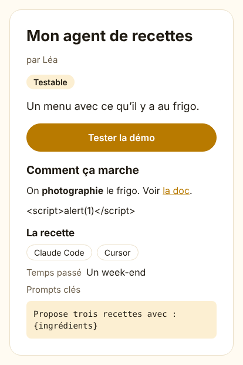
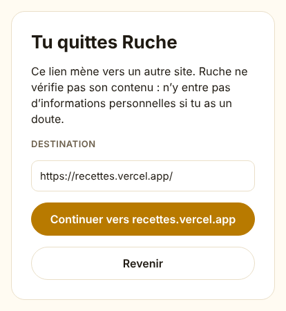

# Leçon 3 — Publier un projet

C'est le cœur de Ruche : publier un projet IA pour que ses proches le découvrent et le testent.
Un projet, c'est un titre, un pitch d'une phrase, une description, un statut (idée, en
construction, testable…), un lien de démo et sa « recette » : les outils utilisés, le temps passé,
les prompts clés. Ruche n'héberge rien d'exécutable : la démo vit ailleurs, Ruche donne le lien.

Trois questions guident cette tranche :

- **Qui voit quoi ?** Un projet privé ne doit apparaître nulle part pour les autres, même avec son
  lien direct.
- **Qui peut modifier ?** Seule l'autrice.
- **Que faire d'un texte écrit par un membre ?** La description et les liens sont des contenus
  **non fiables** : on les affiche sans jamais leur faire confiance.

## 1. Le parcours, de bout en bout

1. Léa touche « Publier un projet ». Elle remplit le formulaire, choisit « Testable » et
   « Moi seulement », colle le lien de sa démo, puis touche « Publier ».
2. L'appli vérifie le formulaire avec les règles partagées (`@ruche/contracts`), puis l'envoie à
   l'API (`POST /v1/projects`). L'API revérifie tout, tire un identifiant au hasard et enregistre
   Léa comme autrice. Ce n'est jamais l'appli qui le dit.
3. Léa arrive sur la page du projet, marquée « Privé : visible par toi seulement ».
4. Max ouvre le même lien : « Ce projet n'existe pas, ou il est privé. »
5. Léa passe le projet en « Les membres de Ruche ». Max le voit maintenant, mais sans les boutons
   « Modifier » et « Supprimer ».
6. Max touche « Tester la démo ». Avant de quitter Ruche, une page lui montre l'adresse réelle.



## 2. Une seule porte pour lire un projet

Toutes les lectures de projets passent par **une seule fonction**, qui reçoit toujours la
personne qui regarde. La règle « public pour les membres, privé pour l'autrice » est écrite une
fois, ici :

```ts title="apps/api/src/projects/load.ts (extrait)"
const visibleTo = (viewerId: string) =>
  or(eq(schema.project.visibility, 'public'), eq(schema.project.authorId, viewerId))

export const loadVisibleProject = async (
  db: Database,
  id: string,
  viewerId: string,
  publicApiUrl: string,
): Promise<Project | null> => {
  // Une adresse mal formée ne peut désigner aucun projet (et ferait échouer la requête SQL).
  if (!ProjectId.safeParse(id).success) return null
  const [row] = await selectProjects(db).where(and(eq(schema.project.id, id), visibleTo(viewerId)))
  return row ? toProject(row, viewerId, publicApiUrl) : null
}
```

La condition va **dans la requête SQL** : « donne-moi ce projet, s'il est public ou si c'est le
mien ». Un projet privé d'un autre membre et un projet qui n'existe pas donnent exactement la même
réponse (`null`, puis « introuvable »). Max ne peut même pas apprendre que le projet existe.

!!! note "Analogie"
    Le guichet d'une bibliothèque : il n'y a qu'une porte pour emprunter un livre, et le bibliothécaire
    vérifie toujours la carte. Personne ne passe par la fenêtre de la réserve.

## 3. Modifier : « refusé » ou « introuvable » ?

Pour modifier ou supprimer, l'API réutilise la même porte, puis vérifie l'auteur :

```ts title="apps/api/src/routes/projects.ts (extrait)"
  const ownProject = async (id: string, userId: string) => {
    const project = await loadVisibleProject(db, id, userId, publicApiUrl)
    if (!project) return 'not_found' as const
    if (!project.isMine) return 'forbidden' as const
    return project
  }
```

- Projet public d'un autre : Max le voit déjà, on lui répond honnêtement « refusé » (403).
- Projet privé d'un autre : « introuvable » (404), sinon on lui révélerait son existence.

Par précaution, la requête de modification répète la condition « dont l'auteur est le membre ».
Si un jour quelqu'un retirait la vérification au-dessus par erreur, la base refuserait quand même
de modifier le projet d'un autre.

Enfin, le schéma `ProjectUpdate` est un `strictObject` : un `"authorId": "max"` glissé dans une
modification fait refuser toute la requête. On ne peut pas « offrir » son projet à quelqu'un, ni
changer son identifiant.

## 4. Les étiquettes d'outils

« Claude Code », « claude-code » et « CLAUDE code » désignent le même outil. Chacun devient une
**étiquette** commune, qui servira à regrouper les projets (tranche 3b) :

```ts title="apps/api/src/projects/slug.ts (extrait)"
export const toolSlug = (label: string): string => {
  const slug = label
    // NFKD sépare les lettres de leurs accents (« é » devient « e » + « ´ »)…
    .normalize('NFKD')
    // … puis on retire les accents (\p{M} : toutes les « marques » Unicode, dans toutes les langues).
    .replace(/\p{M}/gu, '')
    .toLowerCase()
    // Tout ce qui n'est ni lettre (\p{L}) ni chiffre (\p{N}) devient un tiret, un seul à la suite.
    .replace(/[^\p{L}\p{N}]+/gu, '-')
    .replace(/^-+|-+$/g, '') // pas de tiret au début ni à la fin
  if (slug) return slug
  // Un nom fait seulement de symboles (« 🤖 ») : on utilise leurs numéros Unicode (« u1f916 »).
  return Array.from(label.trim(), (char) => `u${char.codePointAt(0)?.toString(16)}`).join('-')
}
```

`\p{L}` veut dire « une lettre, dans n'importe quel alphabet ». « Клод » (en cyrillique) reste donc
« клод », au lieu de disparaître.

## 5. Le lien de démo : une seule règle pour tous les liens

Un lien de démo doit mener à un site public, en https. Facile à dire, piégeux à vérifier : une
adresse peut s'écrire de beaucoup de façons. La règle est écrite une fois, dans les contrats :

```ts title="packages/contracts/src/projects.ts (extrait)"
  if (url.protocol !== 'https:') return null
  // « https://ruche.app@pirate.example » mène à pirate.example : ce qui précède @ est un identifiant.
  if (url.username || url.password) return null

  // Un seul point final est permis (« exemple.com. » est une écriture valide) ; plusieurs, non.
  if (/\.\.$/.test(url.hostname)) return null
  const host = url.hostname.toLowerCase().replace(/\.$/, '')
  // Une adresse IPv4 (4 nombres) plutôt qu'un nom.
  if (/^\d+\.\d+\.\d+\.\d+$/.test(host)) return null
```

On laisse la classe `URL` du navigateur découper l'adresse : elle sait que `https://0x7f.1` et
`https://2130706433` sont deux écritures de `127.0.0.1`, l'adresse de l'ordinateur lui-même, et
les ramène à la forme habituelle. La même fonction sert à trois endroits :

- l'API, pour le lien de démo ;
- l'appli, pour les liens de la description ;
- la page d'avertissement.

!!! note "Analogie"
    Le contrôle d'un billet de train : peu importe comment il a été plié ou photocopié, le contrôleur
    le passe dans la même machine, qui lit le vrai code-barres.

## 6. Le Markdown : afficher sans faire confiance

Une description peut contenir `**gras**`, des listes, des liens… mais aussi un `<script>` piégé.
Sur un site web, la façon habituelle d'afficher du Markdown est de le transformer en HTML, ce qui
demande beaucoup de prudence. Ici, on n'utilise jamais de HTML. La bibliothèque marked découpe le
texte en morceaux (titre, paragraphe, lien…), puis **notre** composant dessine chaque morceau avec
des composants React Native. Tout morceau inconnu est affiché comme du texte, tel quel.

Seuls les liens qui passent la règle de la partie 5 deviennent cliquables :

```tsx title="apps/app/src/ui/Markdown.tsx (extrait)"
        case 'link': {
          // Seul un lien https vers un site public est cliquable (voir publicHttpsUrl) ; les autres
          // (javascript:, http:, adresse IP, réseau local…) restent du simple texte.
          const target = publicHttpsUrl(token.href)
          return target ? (
            <Text
              key={key}
              accessibilityRole="link"
              onPress={() => onLinkPress(target.href)}
              style={styles.link}
            >
              {children(token.tokens)}
            </Text>
          ) : (
            <Fragment key={key}>{children(token.tokens)}</Fragment>
          )
        }
```

Et les images ne sont jamais chargées : une image hébergée ailleurs ferait savoir à son
propriétaire qui lit la page, et quand. On affiche seulement son texte de remplacement.

!!! note "Analogie"
    Un traducteur prudent : il lit la lettre à voix haute, mot pour mot, mais n'exécute aucune des
    consignes qu'elle contient (« ouvrez le coffre »).

## 7. La page d'avertissement

Un lien peut mentir : le texte « le site officiel » peut mener ailleurs. Avant de quitter Ruche,
la page `/out` montre l'**adresse réelle**, telle qu'elle sera ouverte, et le nom du site sur le
bouton.



Un piège bien connu : « аpple.com » avec un « а » cyrillique ressemble trait pour trait à apple.com.
Le navigateur l'écrit sous sa forme réelle, `xn--pple-43d.com`, ce qui démasque l'imitation.
Problème découvert pendant la relecture : sur iPhone et Android, l'outil d'adresses d'Expo ne fait
pas cette conversion. Deux parades :

- l'API enregistre le lien sous sa forme réelle (`xn--…`) ;
- la règle refuse tout nom qui ne serait pas en lettres latines simples après découpage.

## 8. Les pièges trouvés par la relecture de sécurité

Comme pour chaque tranche, un relecteur dédié a essayé de casser le code. Il a trouvé deux
problèmes bloquants, tous deux côté appli.

**Le texte qui fait planter la page.** Une description faite de 3 000 `>` (une citation dans une
citation dans une citation…) épuisait la « pile » de l'analyseur, la mémoire qui garde la trace
des fonctions en cours. Résultat : la page plantait pour tous ceux qui l'ouvraient. Trois parades :

```tsx title="apps/app/src/ui/Markdown.tsx (extraits)"
const parse = (text: string): Token[] | null => {
  try {
    return lexer(text)
  } catch {
    return null
  }
}
```

```tsx title="apps/app/src/ui/Markdown.tsx (extrait)"
  const block = (token: Token, key: number, depth = 0): ReactNode => {
    // Trop profond : le reste du bloc en texte brut.
    if (depth > MAX_DEPTH) {
      return (
        <Text key={key} style={styles.text}>
          {clean(token.raw.trim())}
        </Text>
      )
    }
```

- **`try … catch`** : si l'analyse échoue, on affiche le texte brut au lieu de planter.
- **Une profondeur maximale (6)** : au-delà, le reste s'affiche en texte simple. Le test mesure la
  profondeur réellement affichée : 902 niveaux sans la limite, 30 au plus avec.
- **Un écran de secours** sur les pages concernées : si une page plante malgré tout, un message
  « Cette page n'a pas pu s'afficher » et un bouton « Réessayer » remplacent l'écran blanc.

```tsx title="apps/app/app/projects/[id]/index.tsx (extrait)"
// Si la page plante (contenu piégé, bug…), un écran de secours s'affiche à sa place.
export { RouteErrorBoundary as ErrorBoundary } from '../../../src/ui/RouteErrorBoundary'
```

**Le site déguisé** : voir la partie 7.

Le relecteur a aussi trouvé des améliorations plus mineures. Par exemple, `&#x202E;` (une autre
façon d'écrire le caractère qui retourne le texte) revenait par la fenêtre dans le Markdown : il
est maintenant retiré à l'affichage.

!!! warning "La leçon"
    Un contenu écrit par un membre est lu par **tous** les autres. Un défaut d'affichage n'est donc
    pas « juste un bug » : un seul texte piégé peut gêner tout le monde. On teste toujours avec des
    textes hostiles, pas seulement avec des textes normaux.

## 9. Côté appli : un formulaire, deux usages

Le même écran sert à publier et à modifier. Tout le formulaire tient dans un seul état, et une
petite fonction fabrique le « changeur » de chaque champ :

```tsx title="apps/app/src/screens/ProjectFormScreen.tsx (extrait)"
  const change =
    <K extends keyof ProjectForm>(key: K) =>
    (value: ProjectForm[K]) =>
      setForm((previous) => ({ ...previous, [key]: value }))
```

`change('title')` renvoie une fonction qui ne modifie que le titre. Et grâce à
`<K extends keyof ProjectForm>`, TypeScript vérifie que la valeur a le bon type : impossible de
mettre `'abandonné'` dans le statut.

## Les notions de cette leçon

| Notion | En une phrase | Où la voir |
| --- | --- | --- |
| Contrôle d'accès | Une seule porte décide qui voit quoi | `projects/load.ts` |
| 403 ou 404 | « Refusé » si on voit, « introuvable » sinon | `routes/projects.ts` |
| uuid | Un identifiant tiré au hasard, impossible à deviner | `schema/projects.ts` |
| Étiquette (slug) | La forme commune d'un nom, pour regrouper | `projects/slug.ts` |
| Classe URL | L'outil standard qui découpe une adresse | `contracts/src/projects.ts` |
| Homographe | Un nom qui en imite un autre avec d'autres lettres | `LeavingScreen.tsx` |
| Analyseur (lexer) | Découpe un texte en morceaux typés | `ui/Markdown.tsx` |
| Pile d'appels | La mémoire des fonctions en cours, qui peut déborder | `ui/Markdown.tsx` |
| Écran de secours | Remplace une page qui plante | `ui/RouteErrorBoundary.tsx` |
| Type générique | Un type qui s'adapte (`K extends keyof …`) | `ProjectFormScreen.tsx` |

## Exercices

**1. Le piège des doubles.** Publie un projet avec les outils « Claude Code, claude-code, CLAUDE
code ». Combien d'étiquettes s'affichent sur sa page ? Retrouve dans `projects/load.ts` la fonction
qui les a fusionnées.

**2. Les liens qui mentent.** Dans la description d'un projet, écris
`[Mon site](https://ruche.app@exemple.com)` et `[Ma box](https://192.168.1.1)`. Lesquels sont
cliquables ? Retrouve la ligne de `publicHttpsUrl` qui refuse chacun.

**3. Lire un test d'autorisation.** Dans `apps/api/src/projects.test.ts`, trouve le test
« does not even reveal a private project to another member who tries to change it ». Pourquoi
attend-il 404 et non 403 ? Que pourrait déduire Max s'il recevait 403 ?
