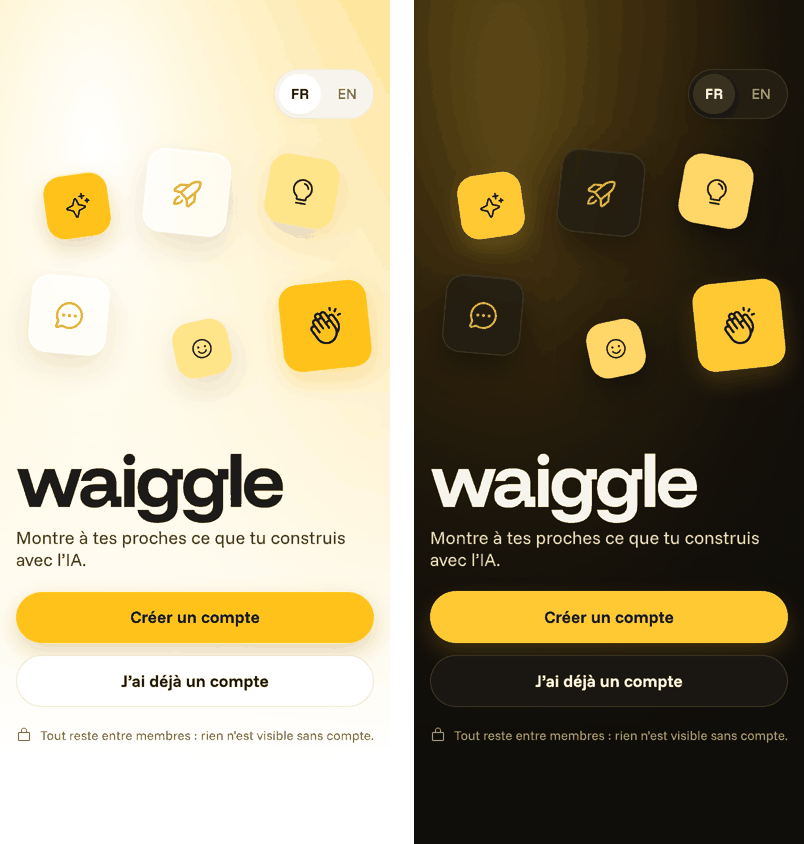
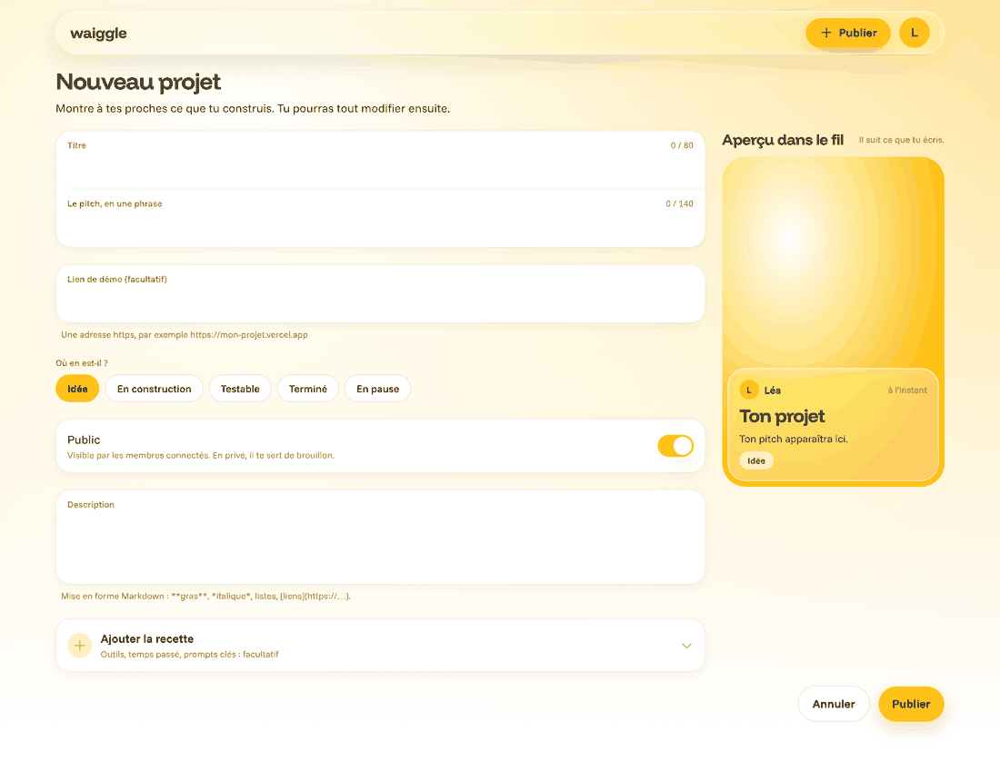

# Leçon 4 — Le design « Miel »

L'appli change d'allure et de nom : elle s'appelle désormais **Waiggle** pour ses membres, et elle
porte la direction visuelle « Miel ». C'est du blanc, du verre et une lumière de miel qui prend la
couleur de ce qu'on regarde, de jour comme de nuit.

Mais le vrai sujet de cette leçon n'est pas la couleur : c'est de **pouvoir changer d'avis
facilement**. Jusqu'ici, chaque écran écrivait ses propres tailles, couleurs et arrondis : une
soixantaine de valeurs, dispersées dans seize fichiers. Pour changer le jaune, il fallait toucher
chaque écran, et en oublier un était facile. Désormais, chaque décision de design vit **à un seul
endroit**, et des vérifications automatiques empêchent de revenir en arrière.



## 1. Le parcours d'un changement

Louis trouve le miel trop orangé. Voici ce qui se passe :

1. Il ouvre `packages/brand/src/colors.ts` et change **une ligne** : `honey: '#FFC21A'`.
2. Les tests vérifient aussitôt qu'un texte posé sur ce miel reste lisible (section 4).
3. Il ouvre la page `/catalogue` de l'appli : tous les boutons, pastilles, interrupteurs et la
   lumière d'accueil ont pris la nouvelle teinte.
4. Il ouvre une pull request. La CI photographie chaque écran, sur téléphone et sur ordinateur,
   de jour et de nuit. Il compare les images avant de valider.

Aucun écran n'a été modifié : ils ne savent pas quelle est la couleur du miel, ils savent seulement
qu'un bouton principal est « miel ».

## 2. Trois étages

Comme une maison : les matériaux, puis les éléments préfabriqués, puis les pièces.

**Les matériaux : les jetons.** Un *jeton de design* est une valeur qui porte le nom de son rôle.
On écrit `textMuted` (« texte discret ») plutôt que « gris #6B675E ». Les jetons vivent dans un
paquet à part, `@ruche/brand`, que l'appli, les e-mails de l'API et un futur site partagent :

```ts title="packages/brand/src/colors.ts (extrait)"
const day = {
  // Fonds
  background: '#FFFFFF', // fond de page
  surface: '#FFFFFF', // cartes, champs, tout ce qui se lit longtemps
  surfaceGrouped: '#F5F5F3', // fond derrière les listes groupées (réglages)
  surfaceRaised: '#FFFFFF', // posé sur un fond groupé : le choix actif d'un contrôle segmenté

  // Textes : l'« encre », de la plus forte à la plus discrète
  text: '#1C1B19', // texte principal et icônes
```

La nuit a exactement les mêmes noms, avec d'autres valeurs. Grâce au mot-clé `satisfies`,
TypeScript refuse de compiler si on oublie une couleur la nuit.

!!! note "Analogie"
    Le nuancier d'un peintre. Il ne mélange pas ses couleurs à chaque tableau : il pioche dans le
    nuancier par leur nom. Pour changer le jaune de tous ses tableaux, il change le pot.

**Les éléments préfabriqués : les composants.** Dans `apps/app/src/ui`, un bouton, un champ, une
surface de verre… Ce sont les **seuls** fichiers qui lisent les jetons. Le bouton principal, par
exemple :

```ts title="apps/app/src/ui/Button.tsx (extrait)"
    primary: {
      box: { backgroundColor: colors.honey, boxShadow: `${shadows.highlight}, ${shadows.honey}` },
      pressed: { backgroundColor: colors.honeyPressed },
      tone: 'onHoney',
    },
```

**Les pièces : les écrans.** Ils ne font plus qu'assembler des composants. Ils disent ce qu'est un
texte (un titre, une légende) et jamais à quoi il ressemble :

```tsx title="apps/app/src/screens/VerifiedScreen.tsx (extrait)"
    <Screen>
      <Stack align="center">
        <Emblem icon="check" />
      </Stack>
      <Text variant="title2" accessibilityRole="header">
        {t('auth.verified.title')}
      </Text>
      <Text tone="secondary">{t('auth.verified.body')}</Text>
      <Button label={t('auth.verified.continue')} onPress={() => router.replace('/')} />
    </Screen>
```

Pas une couleur, pas une taille, pas une marge : si on décide demain que les titres sont plus
grands, cet écran suivra sans qu'on le touche.

## 3. Le jour, la nuit et l'appareil

Le membre choisit son apparence dans les réglages : « Automatique », « Jour » ou « Nuit ».
« Automatique » suit le réglage de l'appareil. Le choix est gardé **sur l'appareil**
(`localStorage` sur le web) : le téléphone et l'ordinateur peuvent avoir chacun le leur.

Un *contexte* React (`ThemeProvider`) porte le thème jusqu'à tous les composants, sans qu'on ait à
le passer de main en main. Le cœur de la décision tient en une ligne :

```ts title="apps/app/src/ui/theme/ThemeProvider.tsx (extrait)"
  const wanted: Scheme = appearance === 'auto' ? (system === 'dark' ? 'night' : 'day') : appearance
```

Quand le choix change, chaque composant qui a appelé `useTheme()` se redessine, d'un coup.

## 4. Les garde-fous

Une règle qui n'est pas vérifiée finit par être oubliée. Trois vérifications tournent à chaque
pull request.

**Le linter interdit aux écrans de dessiner eux-mêmes.** Un écran ne peut pas importer `Text`,
`View` ou `StyleSheet` de React Native. Il doit passer par `src/ui` :

```json title="biome.json (extrait)"
            "noRestrictedImports": {
              "level": "error",
              "options": {
                "paths": {
                  "react-native": {
                    "importNames": [
                      "Text",
                      "TextInput",
                      "View",
                      "ScrollView",
                      "Pressable",
                      "TouchableOpacity",
                      "Image",
```

Le message d'erreur est en français et explique quoi faire : ajouter le composant qui manque dans
`src/ui`.

**Un test refuse toute couleur écrite à la main** dans l'appli, avec une *expression régulière*
(un motif de recherche dans du texte) :

```ts title="apps/app/src/design-rules.test.ts (extrait)"
const colorLiteral =
  /#[0-9a-f]{3}(?:[0-9a-f]{3})?(?:[0-9a-f]{2})?\b|\b(?:rgba?|hsla?)\(|['"](?:white|black)['"]/gi
```

**Un test mesure la lisibilité.** Le *contraste* entre un texte et son fond se calcule : de 1 (deux
couleurs identiques) à 21 (noir sur blanc). Les règles d'accessibilité demandent au moins 4,5 pour
du texte. Chaque couple « texte sur fond » utilisé est vérifié, de jour et de nuit :

```ts title="packages/brand/src/brand.test.ts (extrait)"
  it.each(schemes)('keeps every text readable on its background (%s)', (scheme) => {
    const palette = palettes[scheme]
    for (const { text, on, min } of contrastPairs) {
      const ratio = contrastRatio(palette[text], palette[on], palette.background)
      expect(ratio, `${scheme}: ${text} on ${on} = ${ratio.toFixed(2)}:1`).toBeGreaterThanOrEqual(
        min,
      )
    }
  })
```

Et pour le nom : aucun texte n'écrit « Waiggle » en toutes lettres. On écrit `{{appName}}`, rempli
automatiquement. Renommer l'appli tient en une ligne de `packages/brand/src/name.ts`.

!!! note "Analogie"
    Les détrompeurs d'une prise électrique : la forme de la prise empêche de la brancher à
    l'envers. On n'a pas besoin de se souvenir de la règle, l'objet la fait respecter.

## 5. Le mouvement « comme du miel »

Les boutons s'enfoncent sous le doigt et reviennent avec un léger rebond. Ce n'est pas une
animation d'une durée fixe, c'est un *ressort* : raideur 170, amortissement 18 (`springs.honey` dans
`packages/brand/src/motion.ts`). Il dépasse d'environ 5 % sa position avant de s'y poser, comme
une goutte de miel.

Les animations passent par la bibliothèque Reanimated. Elle anime une *valeur partagée*, un
nombre qui change sans que React redessine le composant :

```ts title="apps/app/src/ui/Button.tsx (extrait)"
  const scale = useSharedValue(1)
  const animated = useAnimatedStyle(() => ({ transform: [{ scale: scale.value }] }))
```

```ts title="apps/app/src/ui/Button.tsx (extrait)"
        onPressIn={() => {
          scale.value = spring(pressScale, 'firm')
        }}
        onPressOut={() => {
          scale.value = spring(1)
        }}
```

Par défaut, tout le monde a toutes les animations. Seule exception : une personne qui a activé
« Réduire les animations » sur son appareil (pour le mal des transports) voit les grands
déplacements remplacés par des fondus.

## 6. La lumière d'ambiance, sans flou coûteux

Derrière chaque écran, une grande lueur douce. Le flou est l'un des effets les plus coûteux à
calculer : le canevas des maquettes, qui en affichait des centaines, figeait le navigateur. L'astuce :
**ne rien flouter**. Une image minuscule, agrandie, est floue par nature. Pour les visuels de
projet (tranche 3b), le serveur calculera un *ThumbHash* : un résumé de l'image en quelques
dizaines d'octets, qui donne la couleur de la lumière.

## 7. Le web : la page du serveur, puis celle du navigateur

Sur le web, chaque page est **préparée à l'avance** par le serveur, sans navigateur : il ne connaît
ni la taille de la fenêtre, ni le mode sombre, ni la langue du visiteur. Au chargement, React
« hydrate » la page : il vérifie que son premier affichage est identique au HTML préparé, puis
prend le relais. S'il diffère, React redessine tout, et peut même laisser des couleurs fausses.

C'est arrivé : un visiteur anglophone, ou en mode sombre, déclenchait cette erreur. La solution :
afficher d'abord **exactement** la version du serveur, puis passer à la vraie juste après. L'écran
lui-même donne le signal, quand il est prêt :

```ts title="apps/app/src/ui/theme/hydration.ts (extrait)"
// Sur téléphone, rien n'est pré-rendu : on est « hydraté » d'emblée.
let hydrated = Platform.OS !== 'web'
const listeners = new Set<() => void>()

/** Appelée une fois le contenu de la page affiché dans le navigateur. */
export const markHydrated = () => {
  if (hydrated) return
  hydrated = true
  for (const listener of listeners) listener()
}
```

!!! note "Analogie"
    Un traiteur livre un plat préparé la veille. On le pose d'abord sur la table tel quel, puis on
    l'assaisonne au goût de chacun. Si on change l'assiette pendant qu'on la pose, tout se renverse.

## 8. Voir sans Figma

Pas d'outil de dessin à tenir à jour en double : **la référence, c'est l'appli**.

- **Le catalogue** (`/catalogue`, en développement) montre chaque composant dans tous ses états,
  avec des boutons Jour / Nuit et Français / English.
- **Les captures** (`pnpm --filter @ruche/app shots`) photographient le catalogue et chaque écran.
  L'API est simulée avec les données des tests : pas besoin de serveur. La CI joint les images à
  chaque pull request, et échoue si une page affiche une erreur.

Sur ordinateur, certains écrans profitent de la place : le formulaire de publication montre à côté
un aperçu de la carte du fil, qui suit la frappe.



## 9. Les pièges évités

- **Un « introuvable » qui se faisait attendre.** Quand une lecture échouait, React Query la
  retentait trois fois par défaut, avec des pauses de plus en plus longues. Un projet supprimé
  mettait donc plusieurs secondes à afficher « introuvable ». Désormais, un refus définitif
  (introuvable, interdit…) n'est jamais retenté (`api/query-client.ts`, avec son test).
- **Les identifiants qui changent.** Les dégradés SVG ont un identifiant. Tiré par `useId`, il
  différait entre le serveur et le navigateur. Il dépend maintenant seulement du thème.
- **Le faux secret.** L'outil qui cherche les secrets oubliés a pris un ThumbHash d'exemple pour
  une clé d'API. C'est un faux positif : il est marqué dans `.gitleaksignore`, avec sa raison.
- **Le serveur des captures.** La relecture de sécurité a montré qu'une adresse piégée
  (`..\..\.env`) pouvait, sous Windows, servir un fichier hors du dossier construit. Le petit
  serveur refuse maintenant ces adresses.

## Les notions de cette leçon

| Notion | En une phrase | Où la voir |
| --- | --- | --- |
| Jeton de design | Une valeur qui porte le nom de son rôle | `packages/brand/src/` |
| Contexte React | Une valeur accessible à tous les composants à l'intérieur | `ui/theme/ThemeProvider.tsx` |
| `satisfies` | TypeScript vérifie une forme sans perdre le détail des valeurs | `brand/src/colors.ts` |
| Contraste | La lisibilité d'un texte sur son fond, de 1 à 21 | `brand/src/contrast.ts` |
| Lint sur mesure | Une règle d'architecture vérifiée à chaque enregistrement | `biome.json` |
| Ressort | Un mouvement décrit par la physique, pas par une durée | `brand/src/motion.ts` |
| Valeur partagée | Un nombre animé sans redessiner le composant | `ui/Button.tsx` |
| Pré-rendu, hydratation | Le serveur prépare la page, le navigateur la reprend | `ui/theme/hydration.ts` |
| ThumbHash | Le résumé flou d'une image en quelques octets | `ui/AmbientLight.tsx` |
| Faux positif | Une alerte justifiée en apparence, mais sans danger | `.gitleaksignore` |

## Exercices

**1. Changer le miel.** Dans `packages/brand/src/colors.ts`, mets `honey: '#FF8A00'` (un orange).
Lance `pnpm --filter @ruche/brand test`. Le test de contraste passe-t-il encore ? Ouvre le catalogue
pour voir l'effet, puis remets la valeur d'origine.

**2. Casser une règle exprès.** Dans `apps/app/src/screens/VerifiedScreen.tsx`, ajoute
`import { View } from 'react-native'`, puis lance `pnpm lint`. Lis le message : que te dit-il de
faire à la place ?

**3. Ajouter une icône.** Choisis une icône sur phosphoricons.com (par exemple `cookie`). Ajoute son
nom à la liste de `apps/app/scripts/icons.mts`, lance `pnpm --filter @ruche/app icons`, puis
affiche-la dans le catalogue avec `<Icon name="cookie" />`. TypeScript accepte-t-il un nom qui
n'est pas dans la liste ?
