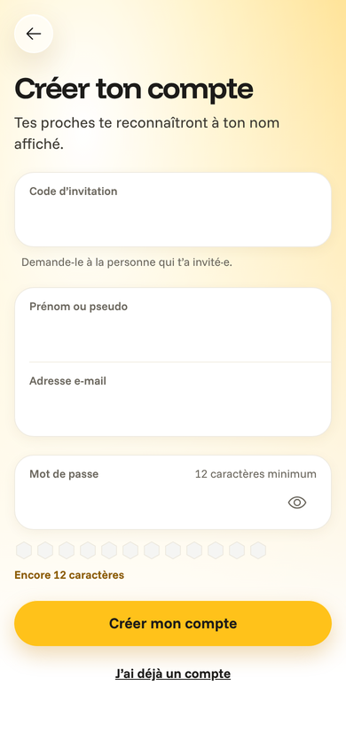

# Leçon 5 — Le code d'invitation

Waiggle va quitter ton ordinateur pour vivre sur Internet, à l'adresse waiggle.io. Or une adresse
publique, n'importe qui peut la trouver : les robots qui parcourent le Web, un curieux, un
inconnu à qui quelqu'un a transféré le lien. La phase 1 s'appelle « MVP en cercle restreint » :
seuls tes proches doivent pouvoir créer un compte.

La solution choisie est la plus simple qui tienne : un **code d'invitation**. Tu le choisis, tu le
donnes à qui tu veux, et l'inscription le demande. Simple à expliquer, mais il faut bien le
faire :

- **Le code ne doit pas pouvoir se deviner**, ni en essayant des milliers de codes, ni en
  chronométrant les réponses du serveur.
- **Le refus ne doit rien révéler** d'autre que « mauvais code » : surtout pas qui a déjà un compte.
- **Il ne doit y avoir aucune autre porte** pour créer un compte.

## 1. Le parcours, de bout en bout

1. Sur le serveur, le code est réglé dans le fichier des secrets : `SIGNUP_INVITE_CODE=…`.
2. Tu envoies à Max le lien `https://waiggle.io/sign-up?code=…`.
3. Max l'ouvre : le champ « Code d'invitation » est déjà rempli, et le code disparaît aussitôt de
   la barre d'adresse.
4. Max remplit son prénom, son adresse et son mot de passe, puis touche « Créer mon compte ».
5. L'appli vérifie le formulaire (un code a-t-il été tapé ?) puis l'envoie à l'API.
6. L'API compare le code **avant tout le reste**. S'il est bon, l'inscription continue comme
   avant, avec l'e-mail de vérification. Sinon : « Ce code d'invitation n'est pas valide.
   Demande-le à la personne qui t'a invité·e. » Aucun compte n'est créé, aucun e-mail ne part.



## 2. Où vit le code : sur le serveur, jamais dans le dépôt

Le dépôt est public : si le code y était écrit, tout le monde pourrait le lire. Il vit donc dans
une **variable d'environnement** du serveur, comme les mots de passe. L'API la lit et la vérifie
au démarrage, avec Zod :

```ts title="apps/api/src/env.ts (extrait)"
    // Le code d'invitation demandé à l'inscription (docs/scenarios/phase-1.md). trim() retire les
    // espaces autour avant de compter les caractères : 12 au moins, pour qu'on ne le devine pas.
    // Absent : inscription libre, ce qui n'est permis qu'en développement et dans les tests.
    SIGNUP_INVITE_CODE: optional(
      z.string().trim().min(INVITE_CODE_MIN_LENGTH).max(INVITE_CODE_MAX_LENGTH),
    ),
```

Et plus bas, une règle qui ne vaut qu'en production :

```ts title="apps/api/src/env.ts (extrait)"
      // En production, l'inscription est fermée par défaut : sans code, le serveur ne démarre pas.
      if (!env.SIGNUP_INVITE_CODE) {
        ctx.addIssue({
          code: 'custom',
          path: ['SIGNUP_INVITE_CODE'],
          message: `required in production, at least ${INVITE_CODE_MIN_LENGTH} characters`,
        })
      }
```

C'est le principe du **« fermé par défaut »** : si quelqu'un oublie de régler le code, le serveur
refuse de démarrer, plutôt que d'ouvrir l'inscription à tout le monde sans que personne ne s'en
aperçoive. Une panne visible vaut mieux qu'une porte ouverte en silence.

!!! note "Analogie"
    Une porte d'immeuble à digicode qui, en cas de coupure de courant, reste verrouillée. L'autre
    choix (s'ouvrir quand le boîtier ne marche plus) serait plus pratique… et bien plus dangereux.

Dernier garde-fou : le serveur refuse aussi les codes qui servent d'exemples dans le dépôt
(« Miel-2026-Noel », celui des tests…). Le dépôt est public, ces codes-là sont connus de tous.

## 3. Comparer deux codes sans rien laisser deviner

Comparer deux textes, ça a l'air simple : `envoyé === attendu`. Mais une comparaison ordinaire
s'arrête **au premier caractère différent**. Un code faux dès la première lettre est donc rejeté
un tout petit peu plus vite qu'un code juste jusqu'à la dixième. En mesurant le temps de réponse
des milliers de fois, un attaquant patient pourrait trouver le code lettre par lettre. On appelle
ça une **attaque temporelle**.

```ts title="apps/api/src/auth/auth.ts (extrait)"
// L'empreinte (SHA-256) d'un code d'invitation, sous sa forme comparable (voir
// normalizeInviteCode). Deux empreintes ont toujours la même longueur : c'est ce que demande
// timingSafeEqual, ci-dessous.
const inviteDigest = (code: string) =>
  createHash('sha256').update(normalizeInviteCode(code)).digest()

/**
 * Le code envoyé est-il le bon ? timingSafeEqual compare les deux empreintes en un temps qui ne
 * dépend pas de leur contenu. Une comparaison ordinaire s'arrête au premier caractère différent :
 * en chronométrant les réponses, un attaquant pourrait deviner le code caractère par caractère.
 */
const isRightInviteCode = (sent: unknown, expected: string) =>
  typeof sent === 'string' && timingSafeEqual(inviteDigest(sent), inviteDigest(expected))
```

Trois idées dans ces quelques lignes :

- **La forme comparable** (`normalizeInviteCode`, dans `packages/contracts`) : on retire les
  espaces autour et on passe en minuscules. « Miel-2026-NOEL » et « miel-2026-noel » sont le même
  code, ce qui évite d'énerver ta tante qui a tapé une majuscule.
- **L'empreinte** (SHA-256) : une sorte de résumé de 32 octets, toujours de la même taille, quel
  que soit le texte. `timingSafeEqual` exige deux valeurs de même longueur : les empreintes la lui
  donnent.
- **`typeof sent === 'string'`** : le visiteur peut envoyer n'importe quoi (un nombre, une liste…).
  Tout ce qui n'est pas un texte est refusé d'emblée.

!!! note "Analogie"
    Un mauvais cadenas à combinaison fait un petit « clic » quand on tombe sur le bon chiffre : un
    cambrioleur l'ouvre à l'oreille, chiffre par chiffre. Un bon cadenas reste muet jusqu'au bout :
    on ne sait qu'à la fin si la combinaison entière est la bonne.

## 4. Avant tout le reste, pour ne rien révéler

L'inscription passe par Better Auth, la bibliothèque qui gère les comptes. Elle permet d'ajouter un
**hook** : une fonction appelée avant chaque route, qui peut tout arrêter en levant une erreur.
C'est là qu'on vérifie le code :

```ts title="apps/api/src/auth/auth.ts (extrait)"
    hooks: {
      before: createAuthMiddleware(async (ctx) => {
        if (ctx.path !== '/sign-up/email') return
        const body: object = typeof ctx.body === 'object' && ctx.body !== null ? ctx.body : {}
        if (inviteCode !== null) {
          const sent = 'inviteCode' in body ? body.inviteCode : undefined
          if (!isRightInviteCode(sent, inviteCode)) {
            // Le message, dans la langue du visiteur ; le code, pour l'appli (accounts/errors.ts).
            const header =
              ctx.headers?.get('accept-language') ?? ctx.request?.headers.get('accept-language')
            const language = resolveLanguage(parseAcceptLanguage(header))
            throw new APIError('FORBIDDEN', {
              code: 'INVITE_CODE_INVALID',
              message: resources[language].translation.auth.errors.inviteInvalid,
            })
          }
        }
```

**L'ordre compte.** Le hook passe avant que Better Auth ne regarde si l'adresse e-mail a déjà un
compte. Avec un mauvais code, la réponse est donc exactement la même, que l'adresse soit connue ou
non. Un test le vérifie :

```ts title="apps/api/src/invite-code.test.ts (extrait)"
  it('answers a wrong code the same way whether the address has an account or not', async () => {
    await ctx.signUp({ ...lea, inviteCode: 'Miel-2026-Noel' })

    const existing = await ctx.signUp({ ...lea, inviteCode: 'faux-code-123' })
    const unknown = await ctx.signUp({
      ...lea,
      email: 'new@example.com',
      inviteCode: 'faux-code-123',
    })

    expect(existing.status).toBe(unknown.status)
    expect(await existing.text()).toBe(await unknown.text())
  })
```

La réponse porte deux informations : un **code** technique (`INVITE_CODE_INVALID`) pour que
l'appli choisisse son message, et un **message** déjà traduit d'après l'en-tête
`Accept-Language` envoyé par le navigateur, pour tout autre programme qui appellerait l'API.

## 5. Et si on essayait tous les codes ?

Better Auth limite déjà les inscriptions à **10 par heure et par adresse IP** (leçon 1). Le hook
s'exécute après ce compteur : chaque essai de code, bon ou mauvais, est compté. Au onzième essai
de l'heure, la réponse est « Trop de tentatives », même avec le bon code. Un test le prouve.

Faisons le calcul avec un code tiré au hasard par `openssl rand -hex 8` : 16 caractères parmi
16 possibles (0 à 9 et a à f), soit 16¹⁶ ≈ 18 milliards de milliards de codes. À 10 essais par
heure, il faudrait des centaines de millions de millions d'années pour tous les essayer. Même avec
des milliers d'adresses IP, c'est sans espoir.

C'est pour ça que la documentation conseille un code **tiré au hasard** plutôt qu'un mot et une
date (« noel2026 ») : ceux-là, un attaquant les essaierait en premier. Et grâce au lien
d'invitation, personne n'a besoin de le taper.

## 6. Une seule porte d'entrée

Aujourd'hui, la seule façon de créer un compte est l'inscription par e-mail. Mais demain, on
ajoutera peut-être « Se connecter avec Google ». Better Auth créerait alors les comptes par une
autre route, **sans passer par notre hook**. La relecture de sécurité l'a repéré : on a ajouté
un second verrou, au moment même où un compte est écrit dans la base de données.

```ts title="apps/api/src/auth/auth.ts (extrait)"
            // Défense en profondeur : avec un code d'invitation, seule l'inscription par e-mail
            // (qui vérifie le code, voir hooks ci-dessus) peut créer un compte. Si un jour une
            // connexion par Google ou par lien magique est ajoutée, elle ne pourra pas créer de
            // compte en passant à côté du code. « return false » annule la création.
            if (inviteCode !== null && context?.path !== '/sign-up/email') return false
```

C'est la **défense en profondeur** : plusieurs verrous indépendants, pour qu'une seule erreur ne
suffise pas à tout ouvrir.

!!! note "Analogie"
    Un immeuble avec un digicode à la porte de la rue ET une serrure à chaque appartement. Si un
    jour quelqu'un laisse la porte du parking ouverte, les appartements restent fermés.

## 7. Côté appli : le lien d'invitation

L'écran d'inscription lit le paramètre `code` de l'adresse (`/sign-up?code=…`) :

```tsx title="apps/app/src/screens/SignUpScreen.tsx (extrait)"
  const params = useLocalSearchParams<{ code?: string }>()
  const codeFromLink = firstParam(params.code) ?? ''
  const hydrated = useHydrated()
  useEffect(() => {
    if (!hydrated || !InviteCode.safeParse(codeFromLink).success) return
    setInviteCode(codeFromLink)
    // Puis on retire le code de l'adresse affichée : il ne reste ni dans l'historique du
    // navigateur, ni à l'écran pendant un partage d'écran.
    router.setParams({ code: undefined })
  }, [hydrated, codeFromLink, router])
```

- **`useLocalSearchParams`** (Expo Router) donne les paramètres de l'adresse de la page.
- **`useHydrated()`** (leçon 4) : sur le web, la page est préparée à l'avance, sans connaître
  l'adresse exacte du visiteur. On attend d'être dans son navigateur pour remplir le champ ;
  sinon la page préparée et la page affichée ne correspondraient pas.
- **`InviteCode.safeParse`** : n'importe qui peut fabriquer un lien. On ne reprend que ce qui a la
  forme d'un code (pas vide, 100 caractères au plus).
- **`router.setParams({ code: undefined })`** retire le code de la barre d'adresse une fois le
  champ rempli.

## 8. Ce que la relecture de sécurité a trouvé

L'agent de relecture a attaqué l'API de test : valeurs piégées (une liste, un objet, un texte de
15 Ko…), variantes d'adresse (`/sign-up/email/`, majuscules…), dizaines d'essais. Rien de
bloquant, mais cinq améliorations, toutes faites :

| Trouvaille | Ce qu'on a fait |
| --- | --- |
| Une route du plugin Expo renvoyait vers n'importe quel site (« redirection ouverte ») | Désactivée : on ne s'en sert pas |
| Une future connexion par Google passerait à côté du code | Le second verrou de la partie 6 |
| Le code d'exemple « Miel-2026-Noel » est public | Refusé au démarrage ; conseil `openssl rand -hex 8` |
| Le code restait dans la barre d'adresse | Retiré dès que le champ est rempli |
| « Noël » peut s'écrire de deux façons invisibles à l'œil | `normalize('NFKC')` les rend identiques |

!!! warning "La leçon"
    Une **redirection ouverte**, c'est un lien sur ton vrai domaine qui emmène ailleurs :
    `https://api.waiggle.io/…?url=https://faux-site.example`. La victime voit « waiggle.io » dans
    le lien, fait confiance, et arrive sur un faux site qui imite le tien pour lui voler son code
    ou son mot de passe. Toute route qui redirige vers une adresse reçue doit vérifier cette
    adresse, ou ne pas exister.

## Les notions de cette leçon

| Notion | En une phrase | Où la voir |
| --- | --- | --- |
| Variable d'environnement | Un réglage donné au serveur, hors du code | `apps/api/src/env.ts` |
| Fermé par défaut | Sans réglage, on refuse plutôt que d'ouvrir | `env.ts`, `superRefine` |
| Attaque temporelle | Deviner un secret en chronométrant les réponses | `isRightInviteCode` |
| Empreinte (SHA-256) | Un résumé de taille fixe d'un texte | `inviteDigest` |
| Hook | Une fonction appelée avant une route, qui peut l'arrêter | `hooks.before` dans `auth.ts` |
| Limitation de débit | Un nombre d'essais maximum par période | `rateLimit` dans `auth.ts` |
| Défense en profondeur | Plusieurs verrous indépendants | `databaseHooks` dans `auth.ts` |
| Redirection ouverte | Un lien de chez nous qui mène n'importe où | `disabledPaths` dans `auth.ts` |
| Normalisation Unicode | Une seule écriture pour un même caractère | `normalizeInviteCode` |

## Exercices

**1. Le serveur qui refuse de démarrer.** Dans `apps/api/src/env.test.ts`, trouve le test
« refuses to start in production without an invite code ». Que se passerait-il en production si
cette règle n'existait pas et que l'on oubliait le code ?

**2. Compter les essais.** Avec un code de 12 chiffres seulement (0 à 9), combien y a-t-il de codes
possibles ? À 10 essais par heure, combien d'années faudrait-il pour tous les essayer ? Et avec un
code de 6 chiffres ?

**3. Lire un test.** Dans `apps/api/src/invite-code.test.ts`, le test « counts wrong codes in the
sign-up limit » envoie dix mauvais codes puis le bon. Pourquoi le bon code est-il refusé ? Est-ce
un problème pour un vrai membre ?
